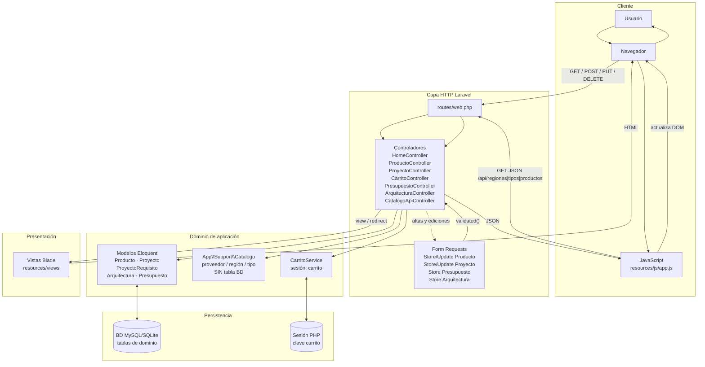

# Diagrama 1 — Arquitectura MVC de Cloud 9 Systems

Fuente: código real (`routes/web.php`, controladores, Form Requests, modelos, `CarritoService`, vistas Blade y `resources/js/app.js`).

## Descripción

La aplicación sigue el patrón **MVC de Laravel**:

1. El **navegador** envía peticiones HTTP.
2. **`routes/web.php`** despacha a un controlador.
3. Cuando hay alta/edición, un **Form Request** valida antes de entrar al método del controlador.
4. El controlador usa **modelos Eloquent**, opcionalmente **`CarritoService`** (sesión) y/o **`Catalogo`** (constantes, no tabla).
5. Los datos persisten en la **base de datos** (excepto el carrito, que vive en sesión).
6. La respuesta es una **vista Blade**, un **redirect** o **JSON** (API de filtros / detalles modales).

No todas las peticiones pasan por Form Request ni por `CarritoService`. El filtrado del catálogo en pantalla usa **JavaScript** y endpoints `/api/*`.

## Diagrama Mermaid



## Recorridos reales (no todos iguales)

| Caso | Ruta (ejemplo) | Form Request | CarritoService | Persistencia | Respuesta |
|------|----------------|--------------|----------------|--------------|-----------|
| Índice | `GET /` → `HomeController` | No | No | No | Blade `home` |
| Alta producto | `POST /catalogo` → `ProductoController@store` | `StoreProductoRequest` | No | Tabla `productos` | Redirect + flash |
| Filtros catálogo (UI) | `GET /api/productos` → `CatalogoApiController` | Validación `Request` | No | Lectura `productos` | JSON → JS |
| Añadir carrito | `POST /carrito/anadir` | Validación inline | Sí | Sesión + lectura producto | Redirect back |
| Crear presupuesto | `POST /presupuestos` | `StorePresupuestoRequest` | Sí (validar + limpiar) | `presupuestos` + pivote | Redirect listado |
| Listar presupuestos | `GET /presupuestos` | No | No | Eloquent `with('productos')` | Blade |

## Flujo canónico de una petición con validación

```text
Usuario → Ruta → Form Request → Controlador → Modelo/Servicio → BD/Sesión → Controlador → Vista/Redirect → Usuario
```

## Notas

- `Catalogo` no es un modelo Eloquent ni una tabla: solo constantes y helpers.
- El carrito **no** tiene tabla en migraciones de dominio.
- Los detalles (producto, proyecto, arquitectura, presupuesto) se exponen como **JSON** desde el controlador y el modal los renderiza en el cliente.
