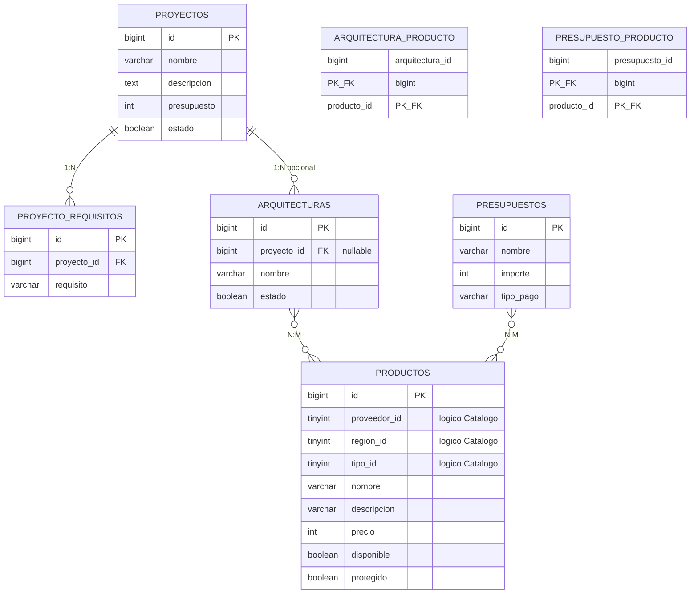

# Diagrama 2 — Modelo entidad-relación (dominio)

Fuente: migraciones `database/migrations/2026_11_07_*` y modelos en `app/Models/`.

## Alcance

Entidades de dominio de Cloud 9 Systems. **No** se incluyen `users`, `cache`, `jobs` ni tablas de sesión.

**No existen** entidades/tablas `proveedores`, `regiones` ni `tipos`: en `productos` son atributos enteros interpretados por `App\Support\Catalogo` (relación **lógica**, sin FK).

## Diagrama Mermaid (ER)

## Cardinalidades y tipología

| Relación | Cardinalidad | Tipo de entidad intermedia | Eloquent | FK física |
|----------|--------------|----------------------------|----------|-----------|
| Proyecto → requisitos | 1 : N | — (entidad débil con PK propia) | `hasMany` / `belongsTo` | Sí |
| Proyecto → arquitecturas | 1 : 0..N | — | `hasMany` / `belongsTo` | Sí, **nullable** |
| Arquitectura ↔ productos | N : M | `arquitectura_producto` | `belongsToMany` | Sí |
| Presupuesto ↔ productos | N : M | `presupuesto_producto` | `belongsToMany` | Sí |
| Producto → proveedor/región/tipo | N : 1 lógico | No hay entidad | Accesorios `Catalogo` | **No** |

## Entidades principales vs intermedias

**Principales:** `productos`, `proyectos`, `proyecto_requisitos`, `arquitecturas`, `presupuestos`.

**Intermedias (solo pivote, PK compuesta):** `arquitectura_producto`, `presupuesto_producto`.

## Relaciones físicas vs lógicas

- **Físicas:** todas las FK declaradas en migraciones (ver diagrama 03).
- **Lógicas sin FK:** `productos.proveedor_id`, `region_id`, `tipo_id` ↔ constantes de `Catalogo`.
- **Sin entidad de carrito:** el carrito es estado de sesión (`CarritoService`), no aparece en el ER.

## Coherencia con Eloquent

- `Proyecto::requisitos()`, `Proyecto::arquitecturas()`
- `ProyectoRequisito::proyecto()`
- `Arquitectura::proyecto()`, `Arquitectura::productos()`
- `Presupuesto::productos()`
- `Producto::arquitecturas()`, `Producto::presupuestos()`
