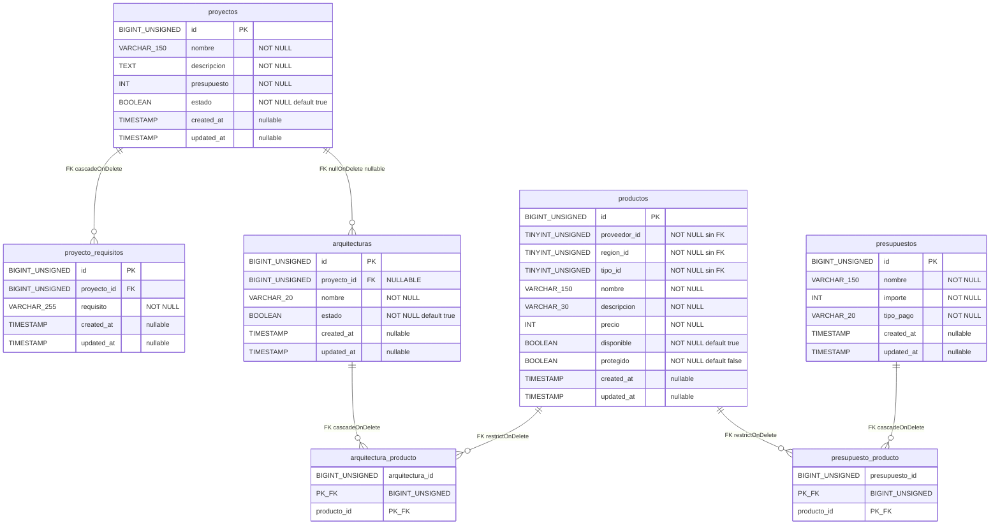

# Diagrama 3 — Modelo relacional físico (tablas)

Fuente exclusiva: migraciones de dominio en `database/migrations/`.

Tipos según Blueprint de Laravel (`id()` → BIGINT UNSIGNED AI; `foreignId()` → BIGINT UNSIGNED; `string(n)` → VARCHAR(n); `timestamps()` → `created_at` / `updated_at` NULLABLE datetime).

## Diagrama Mermaid (estructura física)

## Detalle por tabla

### `productos`
| Campo | Tipo (migración) | Restricciones |
|-------|------------------|---------------|
| id | `$table->id()` | PK |
| proveedor_id | `unsignedTinyInteger` | NOT NULL, **sin FK** |
| region_id | `unsignedTinyInteger` | NOT NULL, **sin FK** |
| tipo_id | `unsignedTinyInteger` | NOT NULL, **sin FK** |
| nombre | `string(150)` | NOT NULL |
| descripcion | `string(30)` | NOT NULL |
| precio | `integer` | NOT NULL |
| disponible | `boolean` default true | NOT NULL |
| protegido | `boolean` default false | NOT NULL |
| timestamps | `timestamps()` | nullable |

Migración: `2026_11_07_210313_create_productos_table.php`.

### `proyectos`
| Campo | Tipo | Restricciones |
|-------|------|---------------|
| id | `id()` | PK |
| nombre | `string(150)` | NOT NULL |
| descripcion | `text` | NOT NULL |
| presupuesto | `integer` | NOT NULL |
| estado | `boolean` default true | NOT NULL |
| timestamps | `timestamps()` | nullable |

Migración: `2026_11_07_210314_create_proyectos_table.php`.

### `proyecto_requisitos`
| Campo | Tipo | Restricciones |
|-------|------|---------------|
| id | `id()` | PK |
| proyecto_id | `foreignId` → `proyectos` | FK, **`cascadeOnDelete()`** |
| requisito | `string(255)` | NOT NULL |
| timestamps | `timestamps()` | nullable |

Migración: `2026_11_07_210315_create_proyecto_requisitos_table.php`.

### `arquitecturas`
| Campo | Tipo | Restricciones |
|-------|------|---------------|
| id | `id()` | PK |
| proyecto_id | `foreignId` → `proyectos` | **NULLABLE**, **`nullOnDelete()`** |
| nombre | `string(20)` | NOT NULL |
| estado | `boolean` default true | NOT NULL |
| timestamps | `timestamps()` | nullable |

Migración: `2026_11_07_210316_create_arquitecturas_table.php`.

### `arquitectura_producto` (intermedia)
| Campo | Tipo | Restricciones |
|-------|------|---------------|
| arquitectura_id | `foreignId` → `arquitecturas` | PK compuesta, **`cascadeOnDelete()`** |
| producto_id | `foreignId` → `productos` | PK compuesta, **`restrictOnDelete()`** |

PK: `['arquitectura_id', 'producto_id']`.  
Migración: `2026_11_07_210317_create_arquitectura_producto_table.php`.

### `presupuestos`
| Campo | Tipo | Restricciones |
|-------|------|---------------|
| id | `id()` | PK |
| nombre | `string(150)` | NOT NULL |
| importe | `integer` | NOT NULL |
| tipo_pago | `string(20)` | NOT NULL |
| timestamps | `timestamps()` | nullable |

Migración: `2026_11_07_210318_create_presupuestos_table.php`.

### `presupuesto_producto` (intermedia)
| Campo | Tipo | Restricciones |
|-------|------|---------------|
| presupuesto_id | `foreignId` → `presupuestos` | PK compuesta, **`cascadeOnDelete()`** |
| producto_id | `foreignId` → `productos` | PK compuesta, **`restrictOnDelete()`** |

PK: `['presupuesto_id', 'producto_id']`.  
Migración: `2026_11_07_210319_create_presupuesto_producto_table.php`.

## Políticas de borrado (resumen)

| Desde | Hacia | Política |
|-------|-------|----------|
| `proyectos` eliminado | `proyecto_requisitos` | CASCADE |
| `proyectos` eliminado | `arquitecturas.proyecto_id` | SET NULL (`nullOnDelete`) |
| `arquitecturas` eliminada | `arquitectura_producto` | CASCADE |
| `productos` eliminado | `arquitectura_producto` | RESTRICT |
| `presupuestos` eliminado | `presupuesto_producto` | CASCADE |
| `productos` eliminado | `presupuesto_producto` | RESTRICT |

## Lo que deliberadamente no aparece como tabla

- Proveedor, región, tipo → constantes `Catalogo` (valores en columnas de `productos`, sin FK).
- Carrito → sesión (`CarritoService::SESSION_KEY`), sin migración de dominio.
- `users` / `cache` / `jobs` → esqueleto Laravel, fuera del modelo de negocio documentado aquí.
